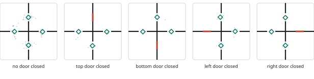
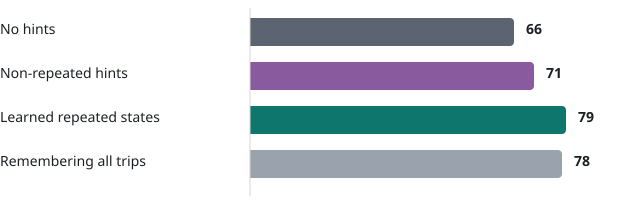
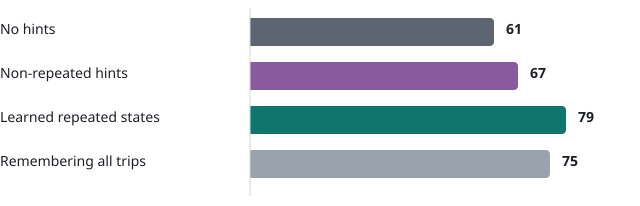
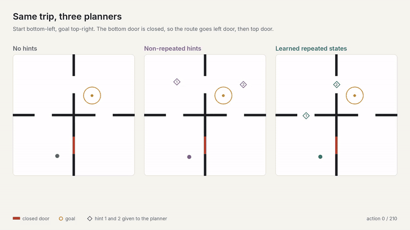
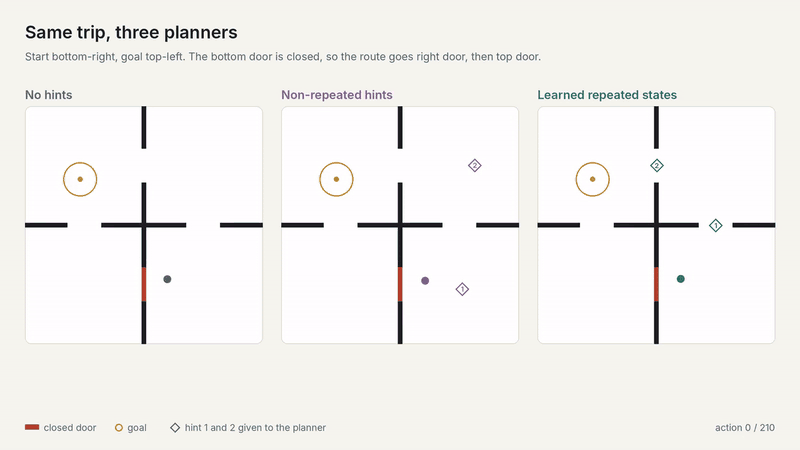

# Learning checkpoints from experience, and planning with them alone

*Status: ongoing project, one small world, two trained models. The full post, with playable videos, is on [my blog](https://boriskrulj.github.io/repo_git/blog/2026/11/learning-checkpoints-from-experience/). It replaces the [earlier lab notebook](https://boriskrulj.github.io/repo_git/blog/2026/11/door-checkpoints-in-a-frozen-h-jepa/) as the summary of where things stand. Last update: 24 November 2026.*

## The objective

There are many ways to reach a goal, but successful attempts keep passing through the same few states. Think of driving from Brussels to Paris: every route is different in the streets, but nearly all of them cross the same border and the same ring road. Those shared states are natural **checkpoints**.

The idea I wanted to test:

1. A robot can **learn** those repeated states by looking at its own successful experience, without anyone labelling them.
2. It can then **plan new trips with the checkpoints alone**, without remembering the trips it learned them from.
3. And they help **because** they are repeated, not just because any hint helps.

The long-term goal is a hierarchy: checkpoints of checkpoints, with as many levels as a task needs. This post is about the first level.

## The setup

I use a frozen, already-trained world model, H-JEPA (Zhang, Terver, Rabbat, LeCun, Balestriero; [arXiv:2610.06805](https://arxiv.org/abs/2610.06805), code at [kevinghst/H-JEPA](https://github.com/kevinghst/H-JEPA)), trained for a four-room navigation task. The robot sees only pictures. One of the four doors may be closed, so some trips have to go the long way round, through two doors. The unmodified planner often heads the wrong way and gets stuck at the closed door.

I never retrain the model. The planner still predicts and replans as before. The only change is that it receives two hints, "pass through here, then here", and prefers plans that follow them.

## How it works

**Learn.** The robot's experience is 1,730 short successful trips, each through a single door. For each trip, I find the state where it comes closest to other similar trips: the most shared point. Then I group those states by how similar the model finds them, with no labels. The groups formed by themselves: exactly **16**, on both models. They turned out to be every open door under every layout (four with no door closed, three for each of the four closed-door layouts). Each learned checkpoint also keeps a summary of the two regions it connects, like a door joins two rooms. After that, the 1,730 trips are thrown away.

*The 16 learned checkpoints (diamonds) of one model, drawn on the map of the layout they belong to; the small dots are the trip states each group was learned from. The red bar is the closed door. Positions are used only to draw this picture; the robot never sees them.*

**Use.** For a new trip, the robot looks at the start picture and the goal picture and picks two of the 16 checkpoints: one whose region contains the start, one whose region contains the goal, linked through a shared region in between. Those two become the hints.

## What came out

Every test was written down before it ran, used trips the method had never seen, and was repeated on two separately trained copies of the model. Success means reaching the goal through the correct doors, within 210 actions.

*Model 42: trips reaching the goal, out of the same 80 fresh trips.*

*Model 43: trips reaching the goal, out of the same 80 fresh trips.*

| | No hints | Non-repeated hints | **Learned repeated states** | Remembering all trips |
|---|---|---|---|---|
| Model 42 | 66 / 80 | 71 / 80 | **79 / 80** | 78 / 80 |
| Model 43 | 61 / 80 | 67 / 80 | **79 / 80** | 75 / 80 |

**1. The learned checkpoints make the planner much more reliable.** Failures dropped from 14 to 1 on one model and from 19 to 1 on the other. Paired on the same trips, the checkpoints won 14 to 1 and 19 to 1 against no hints (exact sign test, p = 0.001 and p < 0.0001).

**2. Sixteen learned states are as good as remembering everything.** An earlier version of the method kept all 1,730 trips and stitched two of them together for each new trip. The 16 checkpoints did at least as well (79 against 78 and 75).

**3. They help because they are repeated.** The control is identical in every way, with the same entries, the same choice and the same tolerance, except that each hint is the *least* shared point of a remembered trip instead of the most shared one. Non-repeated hints barely helped (71 and 67), and the repeated states beat them on every trip where the two differed (8 to 0 and 12 to 0; p = 0.008 and p = 0.0005). The reason is visible in the runs: the robot reached only about 130 of 160 non-repeated hints, against 158 of 160 repeated ones. A spot that one old trip passed is simply not on most routes.

## Two trips, side by side

The same trip, three planners. Left: no hints. Middle: non-repeated hints. Right: the learned repeated states. The red bar is the closed door, the numbered diamonds are the two hints, each line is the robot's recorded path. (Animations; the blog has them as videos.)

*The plain planner pushes towards the closed bottom door. With non-repeated hints, the robot goes to the first hint, a corner of the top-left room, and stalls there. With the learned checkpoints it passes the left door, then the top door, and reaches the goal at action 167.*

*A mirrored trip. Without hints the robot circles at the closed door. The non-repeated hints send it into the corners of the right-hand rooms. The learned checkpoints take it through the right door and the top door to the goal at action 149.*

I picked these from the trips where only the learned checkpoints succeeded, so they show the failure modes, not a typical trip. On most trips all three versions reach the goal.

## How I got here

The route was not straight, and the earlier post shows the dead ends. The first attempt used door labels from the simulator to decide which states were doors; it worked on one model and not on another. Then I gave the planner hints taken from remembered successful trips similar to the new one. That worked well on both models, but a control showed that *any* point of a matching remembered trip worked as well as the shared point. That was honest but a little disappointing: it meant the benefit came from remembering a matching trip, not from checkpoints.

The step that changed the picture was to stop remembering trips. Once the robot keeps only a small set of learned states and has to reuse them for trips it never made, the repeated states clearly beat the non-repeated ones. One detail mattered: a checkpoint on its own was not enough. My first rule for choosing checkpoints, using the checkpoint states alone, chose the right pair on none of 276 practice trips. Storing the two regions each checkpoint connects fixed that on the first try.

## Where it stands

**Shown, in this world, on two models:**
- The robot learns the repeated states from its own successful experience, with no labels.
- Planning with those 16 states alone cuts failures from about one in five to about one in eighty.
- They help because they are repeated: non-repeated hints of the same kind barely help.

**Not shown yet:**
- **A harder world.** Four rooms have an obvious structure, and a trip needs only two checkpoints. The real test is a bigger world, where trips need several checkpoints in a row and the structure is less obvious.
- **Deeper chains and a hierarchy.** Checkpoints of checkpoints, with the number of levels set by the task.
- **Comparison with other methods,** such as landmark-graph planners.
- **Generality.** Two trained copies of one model, one environment. Small numbers of trips (80 per test), so the exact percentages are uncertain.

## What is next

A bigger world with more rooms and longer routes, then chains of three to five checkpoints, then the first step towards the hierarchy. The code is not published yet; I will add it, with the predeclared rules of every test, when it is ready.
